 

 
     
     
     
     
    

My path into AI started on a cricket field. I played cricket professionally until a back injury ended that career. Seven years after my initial studies, I went back to complete my degree in Computer Science, and that's where I found AI.

Today I'm an Applied AI Engineer who builds AI systems that know when they can be trusted. I have built conversational RAG over dense policy documents, worked hands-on with LLM fine-tuning, and turned loosely specified problems into working ML and NLP systems across health, finance, industrial and security domains.
My strongest work is the evaluation that decides where a model can act on its own and where a person must step in. Most recently, I built a human-in-the-loop classifier that automates 51% of decisions at 99.18% accuracy, and grew a library of ~40 broken security detections into 421+ graph-based rules.

I also love writing about tech, especially explaining the intuition behind complex topics so they click for anyone, not just specialists. My blog series on transformers and LLM fine-tuning are a good place to start.

---

## 📋 Career Scorecard

| Innings | Team | Role | Player of the match moment |
|:--|:--|:--|:--|
| 2026 – not out | **Orange Ladders** | AI Consultant | 🎯 Automated **51.1%** of decisions at **99.18%** accuracy. The other 48.9% go to humans, on purpose. |
| 2026 – not out | **Stealth cybersecurity startup** | Founding Engineer | 🛡️ Inherited ~40 broken detections. Left with **421+** working ones. |
| 2025 – 26 | **GrowthArc** | AI Engineer | 🔧 Predicted device failures **7 days early** at ~0.90 PR-AUC |
| 2024 – not out | **IntuitiFi** | Co-Founder | 💬 Built an assistant that reads insurance policies so you don't have to |
| 2023 | **Toosi** | AI Intern | 🎓 Fine-tuned Llama 2. Learned the hard way when *not* to. |

---

## ✍️ I Explain the Intuition

Because "it's just matrix multiplication" has never helped anyone understand anything.

 

---

## Kit Bag

`Python` · `LLMs (GPT-4, Llama)` · `RAG` · `Fine-tuning (LoRA)` · `Weaviate` · `Neo4j` · `FastAPI` · `PostgreSQL` · `Redis` · `LightGBM` · `XGBoost` · `scikit-learn` · `Scrapy` · `FreeCAD` · `Docker`

---

## Currently

- 🧪 Teaching models to say "I'm not sure", the most underrated sentence in AI
- ✍️ Turning one more scary AI concept into something that finally makes sense
- 🌍 Looking for AI work where a wrong answer has real consequences, because that's where getting it right matters most

If you're building AI that people actually depend on, let's talk. If you're not sure your AI needs a human in the loop, let's definitely talk. 
